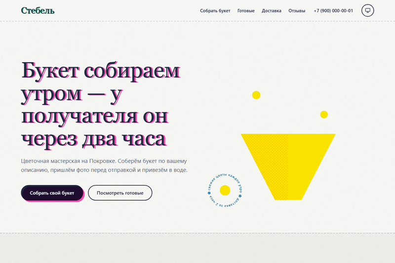
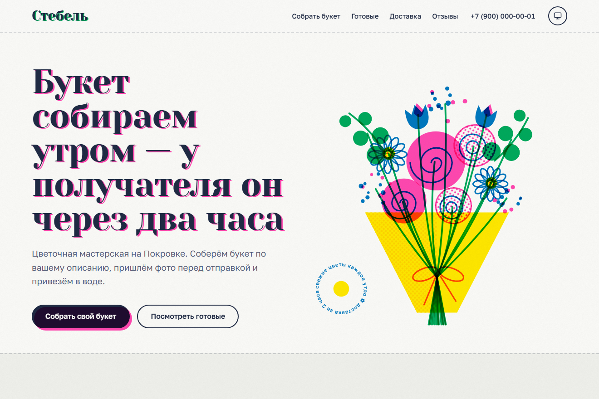
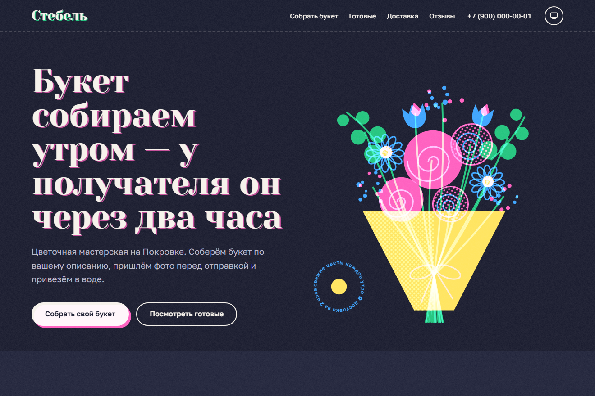
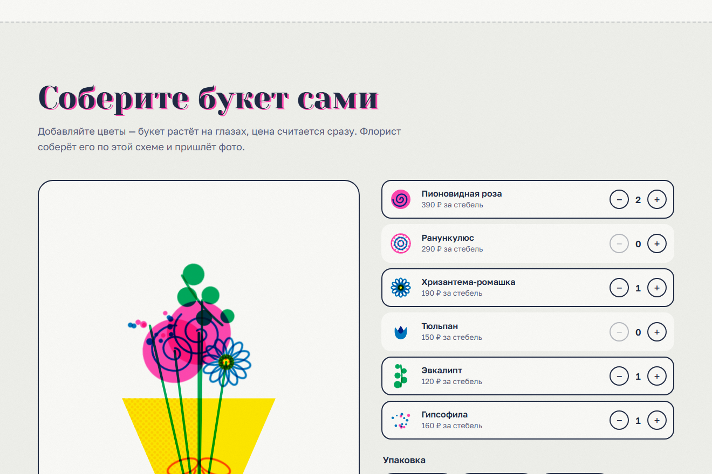
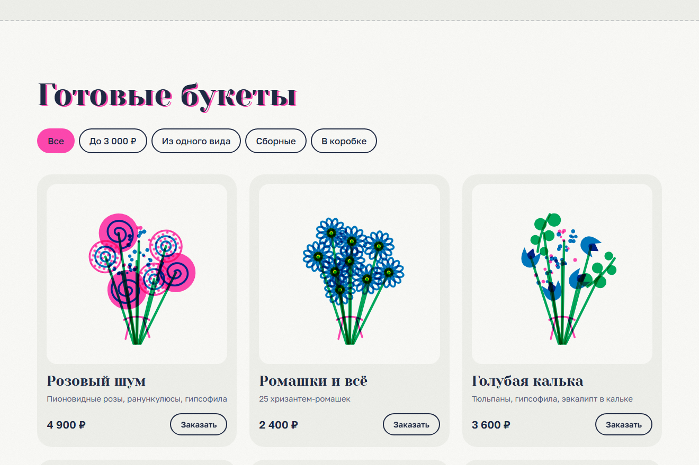

# Стебель — лендинг цветочной мастерской

**Демо:** https://znikdk.github.io/landing-flowers/



Демо-лендинг для портфолио. Ниша: цветочная мастерская с доставкой. Пакет: Бизнес (8 блоков, конструктор).

## Скриншоты

| Светлая тема | Тёмная тема |
|---|---|
|  |  |

| Конструктор букета | Каталог с фильтром |
|---|---|
|  |  |

## Стиль

Ризография: флуоресцентные краски (розовая, зелёная, синяя, жёлтая), растр и слои со сбитым совмещением. Светлая тема — печать на белой бумаге, тёмная — «ночная» печать.

## Интерактив

- Букет в первом экране собирается из отдельных слоёв-красок и расходится за курсором
- Конструктор букета: цветы появляются на схеме по спирали, выбор упаковки, цена считается сразу, состав уходит в форму заказа
- Каталог с фильтром и FLIP-анимацией, процедурные иллюстрации букетов
- Курьер едет по маршруту при прокрутке, стопка отзывов перелистывается перетаскиванием, лепестки после заказа

## Что есть всегда

- Светлая и тёмная тема плюс режим «как в системе», смена темы с круговым «проявлением» (View Transitions API).
- Адаптив от 360 px.
- Анимации учитывают настройку «уменьшить движение» (`prefers-reduced-motion`); тяжёлые эффекты работают, только пока блок на экране.
- Форма заявки: маска телефона, проверка полей, защита от ботов (honeypot) и от двойной отправки.
- Иллюстрации нарисованы кодом (SVG и CSS): без фото и без сторонних JS-библиотек.

## Как перенастроить под клиента

1. `config.js` — название, телефон, почта, Telegram, адрес приёма заявок и данные калькулятора или прайса.
2. `style.css`, блок `:root` — цвета и шрифты обеих тем.
3. Тексты — в `index.html`.

Заявки: если `endpoint` в `config.js` пустой, форма работает в демо-режиме. Для боевого режима укажите адрес функции из проекта [landing-demo](https://github.com/ZniKDK/landing-demo): заявка уходит в Telegram, запасной канал — почта.

## Структура

```
index.html   разметка и тексты
style.css    оформление, темы, анимации
app.js       интерактив этого сайта
config.js    данные клиента
lib/         общие модули: тема, анимации, форма, подстановка данных
```

## Запуск

```bash
python -m http.server 8000
```

Затем откройте http://localhost:8000.

## Лицензии

Код — MIT. Шрифты из Google Fonts под лицензией OFL: Yeseva One, Golos Text. Компания, люди и отзывы вымышлены.
